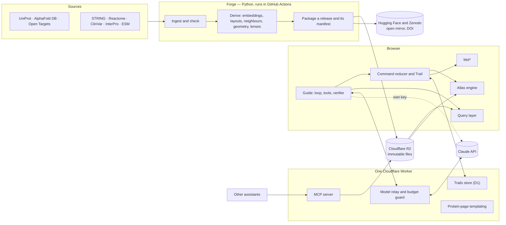

# GenomeCanvas 2.0 — Redesign Plan

**Status:** proposal for review · **Written:** 2026-11-25
**Supersedes:** [`genomecanvas-spec.md`](genomecanvas-spec.md) (v1.0, March 2026) and the August 2026 technology evaluation at the end of [`RESUME_DOSSIER.md`](../RESUME_DOSSIER.md).

**How this was produced.** I read the repository, ran the app locally (backend and frontend) and used it, ran the backend test suite (53 tests pass), measured payload sizes from the existing structure data, counted the human proteome from the UniProt API, and commissioned eight research threads on models, data, competitors, agents, rendering, infrastructure, compute cost and launch venues. The research report with sources is in [`reports/GenomeCanvas 2 redesign research.md`](../reports/GenomeCanvas%202%20redesign%20research.md); raw notes are in `research_notes/`.

**Conventions.** *Measured* means I ran or counted it on 2026-11-25. *Researched* means a research thread found it in a source; the report has the link. *Target* means a number the plan commits to hitting and has not hit yet. *Judgment* means it is my call and you can overrule it.

---

## The short version

**Verdict.** The v1 pitch, a protein universe with an AI guide, has been overtaken. During 2026 funded teams shipped far bigger maps, assistants inside the major protein databases, and chat panels that drive a molecular viewer. Do not rebuild v1 bigger. One part of v1 is still open ground: the guide's answer as a typed script of interface actions. **Make that the product.**

**What 2.0 is.** A free, open atlas of the human proteome in which any question becomes a replayable, sourced walkthrough, made by a person, by the Guide, or by another assistant. It covers all 20,429 reviewed human proteins, each drawn as its real backbone.

**How it is built.**

- **Compute offline, serve files, query in the browser, keep one small Worker.** The reference data needs no database and no backend server.
- A Python pipeline turns about ten open sources into a versioned, citable dataset.
- A custom instanced engine draws the whole proteome in a handful of draw calls. Mol* handles single proteins.
- One typed command vocabulary drives everything. A recorded sequence of commands is a *Trail*: the walkthrough, the shared link, the story, the cached demo and the test, all in one format.
- The Guide runs in the visitor's browser with typed tools. Code, not the model, checks every sentence against the evidence it retrieved.

**What it costs.** About $1 a month, plus a model budget you cap yourself: roughly $2 per 1,000 agent turns on Claude Haiku 5.5.

**The phases.**

| # | Phase | Ships |
|---|---|---|
| 1 | Foundations | A live skeleton with CI, previews and infrastructure as code |
| 2 | The Forge | The whole human proteome as an open dataset with a DOI |
| 3 | The Atlas engine | 20,429 real backbones at 60 fps |
| 4 | Product and design | The new interface |
| 5 | Trails and stories | Shareable walkthroughs, soft launch, **and a test of whether anyone wants them** |
| 6 | The Guide | An agent that authors walkthroughs, with public evals |
| 7 | Lenses | Variant effect, model features, structure comparison |
| 8 | Machine learning | Three predictive features, honestly evaluated |
| 9 | Open platform | MCP, Python package, your own data |
| 10 | Harden, launch, publish | Five-year durability, launch, papers |

About 30 to 38 focused weeks. Phases 5 and 6 are both honest places to stop.

**What you could say when it is done** (these are targets until measured):

- "Draws 20,429 AlphaFold backbones in under ten draw calls at 60 fps in a browser."
- "Built an agent whose every sentence is checked in code against the evidence it retrieved, with accuracy and cost per turn published from a nightly eval."
- "Publishes a reproducible, licence-tracked dataset of the human proteome from ten sources and serves it for a dollar a month."

**The two biggest risks.** It never ships, which is why every phase deploys something and has a cut line. And nobody wants walkthroughs, which is why Phase 5 ends with a demand test and a rule for what to do if it fails.

**What I need from you.** Eight decisions, in section 9. The two that matter most are the framework and host, and which kind of role you are aiming at.

---

## 1. Where the project stands today

### 1.1 What is worth keeping

These are the parts of the current project that are good ideas and survive into 2.0.

| Keep | Why it matters |
|---|---|
| **Typed UI commands, sent before the prose.** The server streams `highlight`, `load_structure`, `set_graph_root` and friends as a separate channel, and the interface reconfigures before the first sentence arrives. | This is the one idea in the project nobody else in this space ships. Section 3 turns it into the core abstraction of the whole product. |
| **Grounded first, model second.** The answer is built from local data; the model only re-narrates it; if the model fails, the grounded answer ships. | The right safety posture for biology. 2.0 keeps the posture and makes it finer-grained (per claim instead of per answer). |
| **Real geometry.** Proteins are drawn as their actual AlphaFold backbones, coloured by AlphaFold's own confidence. | It is the visual identity. 2.0 keeps it and makes it scale. |
| **The honesty habit.** Substituted structures are labelled, measured and estimated figures are kept apart, and bugs are hunted with hostile inputs. | This is the most transferable thing in the repo, and it becomes a product principle: every number on screen says where it came from. |
| **Deterministic builds, self-describing IDs, a repository boundary with a guard test.** | Small disciplines that make a much larger data pipeline tractable. |

### 1.2 What is not working

All of this is first-hand: from running the app at 1440×900 and reading the code.

| Area | What I found | Evidence |
|---|---|---|
| **Data** | The dataset is hand-written, not sourced. 54 proteins split 11/11/11/11/10 across five categories. Layout coordinates are typed to one decimal place. Disease names are free text rather than ontology terms (for example "Multidrug resistance in cancer"). Association scores are round numbers. There are no sequences, so nothing can be embedded. Only the backbone traces are real. | [`proteins.json`](../backend/app/data/proteins.json) *(measured)* |
| **The AI guide** | It is a keyword router with four templates: `"drug" in message` picks one, `"show"` or `"involved"` picks another. With a key set, the model rewrites the template. | [`chat_service.py:44`](../backend/app/services/chat_service.py) |
| **What the guide says** | Asked "What does BRCA1 do?", it answered: *"BRCA1 … is categorized here as a dna_repair protein. The fixture data describes it as e3 ubiquitin-protein ligase that plays a central role in dna repair … In this MVP dataset, BRCA1 is connected to …"*. The code lower-cases the biology ("dna", "e3") and the copy talks about fixtures and MVPs. | Run in the app *(measured)*; [`chat_service.py:106`](../backend/app/services/chat_service.py) |
| **A safety claim that does not hold** | The dossier says a hallucinated ID cannot reach the UI because commands are built from resolved entities. That is true only on the no-model path. When a key is set, the model's JSON replaces the whole envelope, commands included, and the store applies any `target_id` it is given without checking that it exists. I found this by reading the code; I did not reproduce it with a live key. | [`llm_service.py:53`](../backend/app/services/llm_service.py), [`chat_service.py:64`](../backend/app/services/chat_service.py), [`store.ts:340`](../frontend/lib/store.ts) |
| **"Nearby structures"** | For BRCA1 the app lists SLC22A1, MTOR, RAD51, PTEN and NRAS. The metric is the RMSD of two chains each resampled to 180 points, with no alignment. BRCA1 is mostly disordered (average pLDDT 41.6), so this is comparing loose string. The code comments are honest about the limit; the UI label is not. | Run in the app *(measured)*; [`structural_similarity.py`](../backend/app/repositories/structural_similarity.py) |
| **Layout** | Three stacked rows of controls sit above the main view, so the 3D scene starts almost halfway down the screen. At the default zoom the 54 proteins are specks in a dark field. After choosing a protein, the molecular viewer appears as a white box below the fold, with a large empty area above it. | Screenshots at 1440×900 *(measured)* |
| **Visual language** | Every element is a rounded translucent card, often inside another one, with pill buttons. Labels collide ("NAVIGATION" runs into its title). The graph title is the accession "P38398" instead of "BRCA1", and its labels overlap. | Same |
| **Words on screen** | The copy describes the interface instead of the biology: "Universe controls are now persistent", "Interactive neighborhood graph with stable force layout". Internal state is shown as chips: "fit-all", "Universe mode", "0 highlighted proteins". Raw enum values appear: "dna_repair", "alphafold". | Same |
| **Rendering** | Each protein is a React component holding two fat-line objects, a per-frame callback and a text label: about 108 draw calls for 54 proteins. The dossier itself puts the ceiling at 1,000 to 2,000 objects. | [`ProteinUniverse.tsx`](../frontend/components/ProteinUniverse.tsx) |
| **Dependencies** | Next 14, React 18, react-three-fiber 8, FastAPI 0.109, Pydantic 2.5, `anthropic` 0.43, and a default model one generation old. `package.json` declares yarn while the repo uses npm lockfiles. | [`frontend/package.json`](../frontend/package.json), [`requirements.txt`](../backend/requirements.txt) |
| **Reach** | Nothing is deployed. There are no users, no real pipeline, no database, and no evaluation of the guide. | Dossier, confirmed |
| **Licence** | The public repository has no licence file. Legally that means all rights reserved, so the project is not open source yet, and JOSS would not accept it. | GitHub repository metadata *(measured)* |

**The short reading:** the engineering habits are strong and the product is thin. The test suite, the build determinism and the bug-hunting are better than the thing they protect. 2.0 should spend that discipline on something real.

### 1.3 What happened to the old plan

I could not find a file named "2.0 plan" on any branch or elsewhere on disk, so I treated the March spec and the August technology evaluation as the old plan. If there is another document, point me to it and I will reconcile.

| From the old plan | Verdict | Reason |
|---|---|---|
| **March spec** | | |
| Next.js + TypeScript | Change | TypeScript stays. The framework becomes a static build (section 4.3); Next.js 16 is the alternative if you prefer it. v1's Next.js 14 is two major versions behind. |
| Three.js + react-three-fiber | Change | three.js stays. One instanced engine replaces one React component per protein (section 4.7). |
| Mol* | Keep | Integrated from npm, not side-loaded as a script. |
| react-force-graph | Replace | Sigma 4. |
| FastAPI serving requests | Retire | Everything it served was static. Python remains for the pipeline, the package and the evals. |
| Neo4j | Drop | The graph is static and small. Free Neo4j pauses when idle; the embedded alternative was archived. |
| Postgres + pgvector | Drop | 20,429 quantised vectors are 5 MB and are searched in the browser in milliseconds. |
| Redis cache | Drop | Nothing is fetched at request time. Files are immutable and cached by name. |
| ESM-2 embeddings computed by us | Change | Start from UniProt's published embeddings (47 MB, no GPU). ESM models are now MIT and enter in Phases 7 and 8. |
| UMAP to 3D | Change | Computed for real, 2D first, with a published quality score. v1's coordinates were typed by hand. |
| Retrieval over chunked text (RAG) | Change | Typed tools over structured tables with evidence IDs. At this scale there is nothing to chunk. |
| The model writes graph queries | Drop | Measured accuracy of model-written queries on biomedical data is around 60%. |
| Inline `[HIGHLIGHT:X]` markers | Already replaced | v1 moved to typed commands. 2.0 makes them the product. |
| 10,000 "most relevant" proteins | Change | All 20,429 reviewed human proteins. |
| DisGeNET | Drop | Non-commercial licence with a paid tier. Open Targets replaces it. |
| AlphaMissense as "V2, nice to have" | Promote | A core lens in Phase 7. The predictions are CC BY 4.0. |
| STRING, ClinicalTrials.gov | Keep | STRING directly; trials through Open Targets' clinical datasets. |
| User accounts and saved sessions | Change | Shareable links without accounts. |
| "WebGPU is out of scope" | Still right, for now | WebGL 2 draws 20,429 proteins comfortably. WebGPU is held to the same rule as Rust: it comes in when a benchmark earns it. |
| "The full 214 million structures are out of scope" | Keep | More firmly: universe-scale maps exist and are not the product. |
| Five-vendor deployment | Change | One vendor online, at about $1 a month. |
| **August technology evaluation** | | |
| Terraform | Keep the idea | Use OpenTofu, the open-licence fork. |
| Azure Container Apps + Cosmos DB | Drop | It solved for an always-on backend that 2.0 does not have. |
| Neo4j "behind a flag" | Drop | As above. |
| Airflow | Replace | A lighter asset-based pipeline run inside CI. |
| GraphQL, deferred | Still deferred | There is no API to over-fetch from. |
| Rust, conditional | Still conditional | Foldseek does the batch job. Rust enters only for in-browser structure alignment, and only if a benchmark earns it. |
| Swift app | Drop | |
| Kafka, Spark, Kubernetes, Jenkins, Go + gRPC, Kotlin, DynamoDB | Still rejected | For the reasons the evaluation already gave. |

The August evaluation's closing point holds up best of anything in the old plan: *the answer that improved the project was not "which of these can I add" but "here is what is broken, with measurements"*. This plan tries to keep that discipline.

---

## 2. Is the idea still good? The honest answer

### 2.1 What changed while this project sat still

You asked me to be honest about the idea. The competitor research is the part of this plan that matters most, so here it is without softening. All of it is *researched*; the report has the sources.

| What v1 set out to be | Who shipped it, and when |
|---|---|
| **A map of protein space** | The Chan Zuckerberg Biohub's ESM Atlas (May 2026): 6.8 billion sequences and 1.1 billion structures, with natural-language search, an agent and an MCP server. The Protein Universe Atlas covers about 53 million proteins. |
| **An AI guide over protein data** | The Human Protein Atlas added a multi-agent assistant and AI-made gene infographics (v26, 11 November 2026); it says every number it reports is checked against the table cell it cites. cBioPortal added a chat assistant and an MCP server (August). InterPro (September) and Open Targets (January) published official MCP servers. ProtVar added semantic search (June). |
| **A chat that drives a molecular viewer** | PlayMolecule's "Speak to a Protein" pairs a chat panel with Mol*, free, since October 2025. ChimeraX has had an MCP command since December 2025. |
| **A science assistant that shows structures** | Claude Science (June 2026) has more than 60 database connectors and renders 3D structures on paid plans. OpenAI and Google ship free life-science skills. |

And the reception of projects that look like v1 was poor: two comparable open-source explorers have 19 and 49 GitHub stars. On Hacker News, protein viewers scored between 2 and 32 points, and the ESM Atlas launch scored 3.

### 2.2 Verdict

**The v1 pitch, "a protein universe with an AI guide", is no longer distinctive, and 2.0 should not be v1 made bigger.** Bigger maps, broader agents and assistants built into the major databases all exist now, built by funded teams. A solo project cannot win on map scale, on the number of tools an agent can call, or on "chat with a protein".

**One thing in v1 is still open ground, and it is the thing v1 got right almost by accident.** The guide's output is a typed, ordered script of interface actions. It is the only part of the project the research could not find anywhere else:

- The assistants in the major databases answer with text or links.
- MolViewStories, the Mol* team's format for narrated molecular stories, is written by hand in code and has four official examples.
- Neither the Mol* organisation on GitHub nor a registry of 77 biomedical MCP servers contains an agent layer for Mol* or its view format.

Absence is hard to prove, and the web-search allowance ran out part-way through the research. Read "nobody has this" as "not found in the tools, repositories and registries that were checked".

So the recommendation is to **keep the mechanism and change what it is for.** Make the script the product.

### 2.3 The wedge

> **A question about a protein becomes a walkthrough you can replay, check, edit and share.**

A walkthrough is a short sequence of steps. Each step moves the view (fly to this protein, colour by confidence, light up these residues) and makes one claim with its evidence attached. Section 4.5 calls the format a *Trail*. A person can record one by clicking. The Guide can write one from a question. Another assistant can drive one through MCP. Anyone can open the link, step through it, see the sources, fork it and fix it.

Why this is a good place for one developer to stand:

- **It is an artifact, where everyone else produces a chat transcript.** That is also the more interesting AI-product idea to talk about in an interview.
- **Playback is free.** A stored walkthrough needs no model call, so the product can be free and need no login, on a budget of nothing. No other kind of AI feature has that property.
- **It turns the atlas, the graph and the lenses into supporting parts** with a clear job, which is where the old four-panel layout lacked a point.
- **It compounds.** Stories, shared links, the test suite, the cached demo and outside-assistant control are all the same format (section 4.5).

### 2.4 What this means for scope

| Build | Do not build |
|---|---|
| The human proteome with semantic zoom, as **navigation** | A universe-scale map. Biohub has 6.8 billion sequences |
| Walkthroughs as the core artifact, with a recorder and an editor | Chat over protein databases as the headline |
| A Guide that **authors walkthroughs**, checked by code | An autonomous "AI scientist" |
| Residue-level lenses for depth | Clinician-grade variant interpretation |
| The interface exposed to other assistants through MCP | A replacement for PyMOL or ChimeraX; experts are faster by hand |
| | Hosted folding or design, AR/VR, an infinite-canvas board, a knowledge graph as the headline |

"Evidence-first answers" is no longer a differentiator; the incumbents all claim it. It stays as a requirement.

### 2.5 The part I cannot prove

The research found a gap in what is supplied. It found **no direct evidence that students or teachers want this**, and a gap can exist because nobody wants the thing.

There is indirect evidence. The Protein Data Bank's "Molecule of the Month" has run every month since January 2000 and reached its 323rd instalment this November *(researched)*. The Mol* team built MolViewStories in 2025 for narrated molecular scenes, yet eighteen months later only four official examples exist, because each scene is written in code *(researched)*. And, from my own knowledge and not from this research, Proteopedia has many pages built from narrated 3D scenes by instructors and students. All three are laborious to author. The research thread reached the same conclusion independently: authoring cost is the bottleneck.

That is suggestive, not proof. So **Phase 5 ends with a demand test and a stop rule**: put the product in front of ten people, at least three of whom teach. If nobody makes or reuses a walkthrough without being asked, re-aim before building Phases 6 to 10, either toward researchers exploring a gene list or toward the developer platform.

**On attention:** do not expect a protein viewer to trend. The realistic routes to being noticed are the engineering write-ups, the teaching community, and the MCP ecosystem. For a resume none of that is required. What counts there is a deployed, measured, clearly explained system, and that does not depend on going viral.

### 2.6 The name

Keep **GenomeCanvas** *(judgment)*. Today it promises a genome and a canvas and delivers neither. In 2.0 the canvas is the surface where walkthroughs are composed, and the genome is earned through the variant lens and a layout that arranges proteins by chromosome position. I did not search the web for the name, to keep the project out of search queries, so check it for collisions before launch, or tell me to.

---

## 3. What 2.0 is

### 3.1 In one sentence

**GenomeCanvas is a free, open atlas of the human proteome in which any question becomes a replayable, sourced walkthrough, made by you, by the Guide, or by another assistant.**

### 3.2 Five principles

1. **The walkthrough is the product.** Every feature either helps someone make one or makes one better.
2. **Every value says what kind of thing it is:** measured, curated, predicted or generated (section 4.10).
3. **The release is the database.** Reference data is a set of immutable files. The server holds almost nothing (section 4.1).
4. **The interface moves before it speaks.** Kept from v1.
5. **Measure, then claim.** Kept from v1.

### 3.3 Who it is for

| Who | What they come to do | What they leave with |
|---|---|---|
| **Learners, and people who teach or explain** *(primary)* | Understand one protein or one disease mechanism; prepare a class, a talk or a post | A walkthrough they followed, or one they made and shared |
| **Researchers with a gene, or a list of genes** | Get oriented quickly: what is it, what is known, what is nearby, where do my hits fall | A dossier, an enrichment result, a walkthrough to send a colleague. Their list never leaves their machine |
| **Developers and other assistants** | Use the data, or drive the view | An open dataset with a DOI, a Python package, an MCP server |

### 3.4 Three zoom levels and a timeline

- **Atlas.** All 20,429 reviewed human proteins on one map, each drawn as its real backbone. *Layouts* rearrange the same proteins: by similarity, by chromosome position, by location in the cell, by family. Proteins fly from one arrangement to the other.
- **Dossier.** One protein: its structure, a residue strip, the evidence (diseases, drugs, pathways, interactions, expression, literature) and its neighbours.
- **Residue.** One position: how confident the structure is, what a mutation there is predicted to do, which variants are known, and what a protein model recognises at that spot. Each of these is a *lens*.
- **The timeline.** A walkthrough runs across all three. One step can travel from the whole proteome to a single residue.

### 3.5 Feature map

| | Must have | Should have | Stretch |
|---|---|---|---|
| **Atlas** | 20,429 real backbones; semantic zoom; similarity layout; confidence colouring; search | Genome, cell and family layouts; filters; paste a gene list and see enrichment | Other proteomes; multiplayer sessions |
| **Dossier** | Structure viewer with confidence and predicted error; residue strip linked to the 3D view both ways; disease, drug and pathway evidence; neighbours | Expression; literature; interaction graph with path tracing | **History:** how knowledge of this protein changed over time (UniProt keeps 316 dated versions of the p53 entry back to 1988, and nobody has built an interface on that) |
| **Lenses** | Confidence; variant effect; domains and sites | Model features; clinical variants with 3D clustering | A custom lens from your own CSV |
| **Walkthroughs** | Record, replay, share by link; six to eight reviewed stories; deterministic replay | An editor (reorder, rewrite, annotate, fork); export to MolViewSpec; embed in a page | Export to video; a community gallery contributed by pull request |
| **Guide** | Replay and deterministic levels; hosted and own-key agent; verification in code; public evals | Standard questions answered ahead of time for every protein | Local-model adapter |
| **Machine learning** | Similarity map and structural neighbours, with scores | Place my sequence; a view of understudied proteins | Hypothesis links |
| **Platform** | Open dataset with a DOI; documentation | MCP server; Python package | The canvas embedded inside other assistants; notebook widget; self-hosting |

### 3.6 Design direction: an instrument, not a spaceship

Eight rules. Each one fixes something in section 1.2.

1. **The view is the page.** The atlas fills the window and controls float over it. The main view gets at least 80% of the screen. v1 put three rows of controls above it.
2. **Colour belongs to the data.** Neutral surfaces and one accent. No glass panels, glow, starfield or sparkles. The confidence palette should be the brightest thing on screen.
3. **Words are about biology.** No copy describes the interface, no internal state is shown, and no raw enum value reaches the screen.
4. **Three typefaces with three jobs:** a sans-serif for the interface, a monospace for identifiers and sequences, a serif only for story prose.
5. **Tables and tracks for tabular things.** A card only when something is a discrete object, and never a card inside a card.
6. **Motion explains.** A transition shows where things went: layouts morph and zooms are continuous. Under 400 ms, and off when the system asks for reduced motion.
7. **Keyboard first.** One command bar searches, acts and asks.
8. **A flat, labelled map with standing proteins.** A flat layout is legible: labels, lasso selection and a minimap all work. The third dimension is spent on the proteins themselves, which are 3D objects, and not on scattering them through space.

Both a dark and a light theme, because walkthroughs will be projected in classrooms and pasted into slides. Every visual view has a non-visual equivalent (a table of what is on the map, a text list of a walkthrough's steps).

---

## 4. Architecture

### 4.1 The thesis

**Compute offline. Serve files. Query in the browser. Keep one small Worker.**

| Choice | What it buys |
|---|---|
| **Compute offline** | No GPU and no database online. Every expensive operation happens once per data release. |
| **Serve files** | Free delivery, permanent caching because files are named by their contents, nothing to pause or patch. This is what makes a five-year maintenance promise believable at no cost. |
| **Query in the browser** | A visitor's gene list or sequence never leaves their machine. Queries are local, so they are fast and cannot overload a server. |
| **One small Worker** | Only for what a file cannot do: relay model calls under a budget, store shared walkthroughs, speak MCP, and stamp a title into a protein's page. |

v1 was already pointing here. Its dossier notes "zero external calls at request time; everything is precomputed and in memory". 2.0 removes the server that held the memory.

### 4.2 System map



### 4.3 Stack decisions

Every row names what was rejected. The right-hand column is as much a part of the design as the left.

| Layer | Choice | Why | Considered and rejected |
|---|---|---|---|
| **App framework** | React 19, Vite 8, TanStack Router, built to static files | The app is a client-side instrument over static data, and nothing in it needs a rendering server. Static files on Cloudflare carry no bandwidth charge and there is no server to patch. | **Next.js 16 on Vercel's free plan.** It is the lower-friction path and the one you know. It costs a 100 GB monthly transfer guideline *(measured from Vercel's page)*, a server framework that shipped security releases almost monthly in 2026 *(researched)*, and features this app would not use. This one is close, so it is in section 9 as your call. |
| **Hosting** | Cloudflare for everything online: static assets, R2, one Worker, D1, Durable Objects | One vendor. Requests for static assets are free and unlimited *(I read the billing page)*. R2 supports the byte-range requests that Parquet needs; the static-asset host does not. | The old spec's Vercel + Render + Neo4j Aura + Supabase + Upstash: five vendors, two of which pause when idle. The August design on Azure Container Apps and Cosmos DB: $13–15 a month for capacity a static design does not need. |
| **3D engine** | three.js r187 with its long-standing WebGL 2 renderer and hand-written shaders, instanced geometry only. A two-day spike opens Phase 3 to confirm it. **WebGPU is deferred until a benchmark earns it.** | At 20,429 proteins the whole atlas is a handful of instanced draw calls, and WebGL 2 does that in every current browser. WebGPU's advantages (compute shaders for culling, lower cost per draw call) matter at hundreds of thousands of objects, not here. It reaches about 83–89% of users, three.js's own manual still calls its WebGPU renderer experimental, and that renderer does not accept ordinary shader code. Coding agents also write WebGL shaders more reliably than the newer shading language. *(The facts are researched; the conclusion and the last point are my judgment.)* The engine's interface is narrow enough to take a second backend later, most likely at the 576,073-protein stretch level, with a before-and-after measurement. | **Starting on the WebGPU renderer.** That was my first draft, and the research report argued me out of it. If you want WebGPU on the page from the start, say so; the cost is building the centrepiece on a renderer its own maintainers call experimental. Also rejected: react-three-fiber inside the frame loop (one component per protein was v1's ceiling) and deck.gl (its WebGPU backend is "not production ready" by its own guide). |
| **Molecular viewer** | Mol* 5.13 from npm, run headless with our own controls; MolViewSpec for export | It is the standard, it has a built-in confidence theme in AlphaFold's colours, and it accepts per-residue colours from outside data. Loaded only when a protein is opened. | v1's side-loaded script tag. Mol*'s stock interface, which brings its own skin and a React 18 renderer. 3Dmol.js and NGL. |
| **Graph view** | Sigma 4 with graphology | MIT-licensed and comfortable at a few hundred nodes, which is all a neighbourhood needs | react-force-graph (v1); cosmos.gl, built for graphs far larger than this shows |
| **Residue tracks** | Custom canvas tracks for the four that define the product (confidence profile, domains, variant lollipops, the AlphaMissense position-by-substitution map); EMBL-EBI's Nightingale components for the long tail | Nightingale is MIT-licensed, released regularly, and already encodes UniProt and AlphaFold conventions *(researched)*. The defining tracks need the app's own visual language. No maintained predicted-error heatmap component exists, so that one is built in-house. | JBrowse 2 and igv.js: genome-coordinate tools, heavy for a protein-first app |
| **State** | Zustand, behind the command reducer | Already in v1 and adequate. The reducer is the real design (section 4.5). | — |
| **Data in the browser** | Typed arrays for geometry, layouts and vectors; hyparquet for per-protein rows over range requests; DuckDB-WASM loaded only for ad hoc queries | hyparquet is about 0.3 MB. DuckDB-WASM is 6.2 MB compressed and single-threaded *(researched)*, so it stays off the critical path. | DuckDB-WASM for everything |
| **Search** | A lexical index plus a brute-force scan of quantised vectors, in plain JavaScript | A scan of 570,000 binary vectors takes 33–59 ms in single-threaded JavaScript *(measured by the rendering research thread)*. For 20,429 proteins it is a few milliseconds. | Any vector database. WebAssembly for search: not needed. |
| **Interface kit** | Tailwind 4, shadcn/ui on Base UI, Motion 14 | Current defaults, all MIT | GSAP: free to use but under a proprietary licence, which is the wrong fit for an open-source project |
| **Pipeline** | Python 3.13; Dagster assets run inside GitHub Actions; DuckDB and Polars; Pandera checks; Foldseek; gemmi | Four releases a year. Assets with checks and lineage. Free runners with 16 GB of memory. | Airflow (a server for a quarterly job), Spark, Kafka. *Orchestrators were not researched this round, so Dagster is my judgment. If it is not earning its weight after a month, plain staged scripts with a content-addressed cache do the same job.* |
| **Reference data** | Immutable Parquet and binary files on R2 (section 4.4) | Free, fast, never pauses | Postgres with pgvector: no free tier holds the larger vector sets, and scale-to-zero adds delay |
| **Graph storage** | Compact adjacency files, traversed in the browser | Neo4j's free tier pauses after three idle days and is deleted after thirty. Kùzu was archived in October 2025. Postgres's graph-query feature was committed in March 2026 and reverted in September. *(all researched)* | Neo4j, in both the old spec and the August evaluation; Kùzu; Apache AGE |
| **User-generated state** | Cloudflare D1 for Trails; a Durable Object for the budget counter and, later, shared rooms | Free, SQLite-based, never pauses | Supabase (pauses after seven idle days); Cosmos DB |
| **Agent** | TypeScript with the official Anthropic SDK; tools run in the browser; Inspect AI for evals | Section 4.6 | A Python agent behind FastAPI: the tools need the browser's state. The Claude Agent SDK: it runs a command-line subprocess needing about 1 GB per session *(researched)*, which rules out browser and edge. |
| **Backend API** | None for reference data. One Worker for the relay, Trails, MCP and page templating. | Every byte v1's API served was static. | FastAPI in the request path. **Python stays**, as the pipeline, the package and the evals. |
| **Infrastructure as code** | OpenTofu | Open licence; Terraform moved to a business-source licence | Terraform; configuring by hand |
| **CI/CD** | GitHub Actions | Free for public repositories | Jenkins |
| **Conditional** | Rust compiled to WebAssembly, for structure alignment only | No maintained browser build of TM-align, Foldseek or Foldcomp exists *(researched)*, so a small aligner would be a reusable contribution in its own right. Adopted only if it clearly beats JavaScript. | Rust for search or parsing: measured, not needed |

**Deliberately absent:** Kubernetes, Kafka, Spark, Redis, a graph database, a vector database, GraphQL, gRPC, a mobile app, user accounts. The August evaluation rejected most of these with numbers, and nothing since has changed the answer.

### 4.4 Data: sources, licences and the release format

**Scope of the first release: every reviewed human protein.** UniProt release 2026_04 (4 November 2026) has **20,429** of them, totalling **11,417,710 residues** (mean length 559, median 415, longest 34,350) *(measured from the UniProt API)*. That is small enough to ship to a browser and large enough to be the real thing. The old spec's "10,000 most therapeutically relevant" filter is unnecessary.

#### Sources

| Source | Version checked | What 2.0 takes from it | Licence | Status |
|---|---|---|---|---|
| **UniProt** (Swiss-Prot, human) | 2026_04 | Names, sequences, function text, sites, domains, modifications, location, isoforms. Also ready-made **ProtT5 embeddings for the whole human proteome: one 47 MB file**, so the first map needs no GPU. | CC BY 4.0 | Count and file *measured* |
| **AlphaFold DB** | v6 | Coordinates (BinaryCIF), per-residue confidence, predicted aligned error, and a per-protein AlphaMissense table. Human proteome archive is **4.8 GB**. BRCA1's BinaryCIF is 543 KB against 1.7 MB as text CIF. | CC BY 4.0 | *Measured* |
| **AlphaMissense** | 2023 release | Predicted effect of every possible single amino-acid change. 35,397 rows for BRCA1. | **CC BY 4.0** per the project README. A Zenodo copy still shows the older non-commercial licence, so take the files from AlphaFold DB or the bucket named in the README and record the README as the licence source. | *Measured* |
| **Open Targets Platform** | 26.09 (24 Sep 2026) | The backbone of the knowledge graph: targets, diseases, association scores overall and by evidence type, drugs, mechanisms, clinical records, tractability, essentiality, safety, interactions, GO, Reactome, baseline expression. About 60 Parquet datasets. | CC0 1.0 | Listing *measured* |
| **STRING** | 12.5 | Protein–protein functional links with confidence scores. | CC BY 4.0 | *Researched* |
| **Reactome** | 98 (27 Oct 2026) | Pathways and their hierarchy. | CC0 | *Researched* |
| **ClinVar**, **gnomAD** 4.1.1 | current | Clinically classified variants; gene-level constraint. | Open; exact terms to confirm in Phase 2 | Not yet verified |
| **InterPro**, **TED** domains | current | Domain and family boundaries, including domain segmentation of AlphaFold models. | Open; exact terms to confirm in Phase 2 | Not yet verified |
| **ESM models** (Chan Zuckerberg Biohub) | 2026-05-27 release | ESM C embeddings, and the official sparse-autoencoder features used for the "model features" lens (section 4.8). Computed by us, once. | **MIT**, code and weights *(I read the licence file)* | *Measured* |
| **Human Protein Atlas** | 26.0 (11 Nov 2026) | Tissue and cell-type expression. | CC BY 4.0 for its own content; some third-party parts differ | *Measured* (release and licence pages) |
| **Europe PMC**, **PubTator3** | live APIs | Literature evidence and publication counts, fetched on demand. | Open APIs; limits to confirm | Not yet verified |

**Kept apart or left out.**

- **ChEMBL** (release 37) is CC BY-SA 3.0. Drug data that arrives through Open Targets is covered by Open Targets' CC0 release. Anything pulled from ChEMBL directly goes in a separate share-alike layer with its own licence file.
- **DisGeNET** is out: CC BY-NC-SA with a paid licence for products *(researched)*. The old spec relied on it; Open Targets replaces it.
- **AlphaFold 3** outputs are out: non-commercial, share-alike. Open models (Boltz-2, OpenFold3, ESMFold2) cover the same ground if folding is ever needed.
- **OMIM, DrugBank, PhosphoSitePlus** are out for licence reasons.

**Four known holes the pipeline must handle:**

1. **216 human proteins are longer than 2,700 residues**, and the AlphaFold DB API returns nothing for them *(measured: I tried BRCA2 and titin, both 404)*. They exist only in the bulk archive, cut into overlapping 1,400-residue fragments. The pipeline reads the archive, shows these proteins fragment by fragment, and labels any stitched view as an approximation. This replaces v1's procedural helix for BRCA2 and ATM.
2. **The API now returns several entries per accession** (eight for BRCA1) because v6 includes isoforms *(measured)*. The pipeline must select the canonical one explicitly.
3. **The structures and the protein list come from different UniProt releases.** AlphaFold DB v6 was built against release 2025_03 and the list is 2026_04 *(researched)*. The build compares sequences and reports every mismatch; it does not assume they agree.
4. **UniProt's embedding file reportedly omits sequences longer than 12,000 residues** *(researched)*. Three human proteins are that long: titin, mucin-16 and one more *(measured count)*. Those three are embedded by us or placed by a labelled fallback.

#### The licence ledger

One file, `forge/sources.yaml`, with a row per source: version, URL, licence, licence URL, date checked, required attribution. CI fails if a source has no row or the check is older than 180 days. Every release embeds the ledger in its manifest, and the app's Sources page is rendered from it. The rows marked "not yet verified" above are the first entries on the Phase 2 checklist.

#### The release

A release is a folder of immutable files, named by content hash, plus one manifest. It is published to three places: Cloudflare R2 (what the app reads), Hugging Face (open dataset, discoverable by ML people) and Zenodo (a DOI, so it can be cited).

| File group | Contents | Size |
|---|---|---|
| `proteins.parquet` | One row per protein: IDs, names, length, summary statistics, layout coordinates | a few MB |
| `points.bin` | Position and colour for every protein, for first paint | **about 150 KB** *(target)* |
| `backbone.lod16.bin` | 16 points per protein, quantised | **2.3 MB** *(measured: 112 bytes per protein)* |
| `backbone.lod64/` | 64 points per protein, in map tiles | 8.8 MB total *(measured: 448 bytes per protein)* |
| `backbone.full/` | Every alpha-carbon, one shard per protein, fetched on demand | **80 MB** total, 3.8 KB mean *(measured: 7 bytes per residue)* |
| `embeddings.q8.bin` | Embeddings reduced to 256 dimensions and quantised to one byte each | about 5 MB |
| `graph/` | Nodes and edges as Parquet, plus a compact adjacency file per edge type | 25–40 MB *(estimate: 1.5–2.5 M edges)* |
| `residues/` | Per-protein residue tracks: confidence, AlphaMissense, domains, sites, model features | 300–600 MB total, fetched per protein *(estimate)* |
| `structures/` | BinaryCIF mirror of the human proteome, so links survive AlphaFold DB version changes | 3–4 GB *(estimate)* |
| `manifest.json` | Source versions, licences, row counts, checksums, code commit | small |

Quantised backbone data does not compress further (gzip saved under 4% in my test), so these are the sizes on the wire. Everything fits inside R2's 10 GB free allowance with room to spare.

**Why files and not a database.** The reference data changes four times a year, when the sources publish. Between releases it is read-only. Immutable files behind a CDN are faster than any free database tier, cost nothing, never pause when idle, and can be kept online for five years without maintenance, which is exactly what the journals in section 6 require. The same Parquet files are queried in three places with the same SQL: in the browser (DuckDB-WASM), in a notebook or on the command line (DuckDB), and by the MCP server.

### 4.5 The command protocol and Trails

This is the centre of the design. Everything else plugs into it.

**One typed vocabulary describes everything the interface can do.** A click, a keyboard shortcut, the Guide, a saved story, a shared link, an outside assistant and a test all produce the same thing: a command.

```ts
type Command =
  | { type: "focus";    entity: EntityId; level?: "atlas" | "dossier" | "structure" }
  | { type: "select";   entities: EntityId[]; mode: "replace" | "add" }
  | { type: "layout";   name: "similarity" | "genome" | "cell" | "family" }
  | { type: "lens";     name: "confidence" | "pathogenicity" | "features" | "expression"; params?: LensParams }
  | { type: "filter";   where: FilterSpec }
  | { type: "residues"; protein: UniProtId; ranges: [number, number][]; label?: string }
  | { type: "path";     nodes: EntityId[] }
  | { type: "compare";  a: UniProtId; b: UniProtId }
  | { type: "annotate"; anchor: Anchor; text: string }
  | { type: "panel";    open: PanelId[] };
```

Four rules:

1. **Every command is validated against the release before it is applied.** An ID that does not exist is rejected and the rejection is returned to whoever sent it. This closes the hole in v1 (section 1.2), where the store applied whatever ID arrived.
2. **The reducer is a pure function**, `(state, command) → state`. It runs in the browser, in Node and in tests, with no rendering attached.
3. **Every command can be undone.** That gives undo, redo and scrubbing for free.
4. **Commands say what, never how.** A command focuses a protein; the engine decides how the camera gets there. Camera poses are not part of the vocabulary, so a Trail recorded on a laptop replays correctly on a phone.

**A Trail is an ordered list of steps, pinned to a data release.** Each step is a command, optionally with a claim: a sentence, the evidence rows behind it, and what kind of evidence it is.

```ts
type Trail = {
  version: 1;
  release: "2027.01";               // the data release it was recorded against
  title: string;
  steps: Array<{
    command?: Command;
    claim?: { text: string; evidence: EvidenceId[]; kind: "measured" | "curated" | "predicted" | "generated" };
  }>;
};
```

One format, seven uses:

| Use | How |
|---|---|
| **Share** | Any state is a link. A long investigation is a short ID pointing at a stored Trail. |
| **Stories** | A guided story is a Trail with written narration. |
| **Agent output** | Every Guide run is recorded as a Trail, so it can be replayed, shared and inspected step by step. |
| **Free demos** | Replaying a Trail costs nothing and has no latency. Visitors see the agent's work without anyone paying for a model call. |
| **Tests** | An end-to-end test is a Trail plus assertions. The stories are the regression suite. |
| **Outside assistants** | An MCP client drives the app by sending commands (section 4.6, Phase 9). |
| **Release diffs** | Replay the same Trail on two data releases and compare the claims that changed. |

**What the model sees.** Each turn, the Guide is given a compact snapshot of the view: what is focused, what is selected, which layout and lens are active, which panels are open, and the last few steps. Tools return two payloads: a short one for the model and the full rows for the interface. Both practices come from agent integrations that work in other tools (tldraw's agent kit and the Kepler.gl assistant) *(researched)*.

**Interoperability, kept modest.** The `focus` and `residues` commands compile to MolViewSpec, the declarative view format Mol* already reads, so a molecular view can be exported and opened elsewhere. The research found no existing agent that drives Mol* this way. An adapter to the AG-UI event format is possible later if a second front end ever needs it; it is not in the plan.

### 4.6 The Guide

**What the research says about the problem** *(all researched; sources in the report)*:

- On biomedical databases, the best model writes correct SQL 58–63% of the time; experts manage 90%.
- In one audit, 50–90% of model-written medical answers were not fully supported by the sources they cited.
- General-purpose biology agents score poorly on database questions: 17% on one open-answer benchmark, and one frontier model scored 0.058 on database questions without tools against 0.80 on literature questions with them.
- Scaffolding matters more than domain-specific training.

So the Guide is deliberately narrow. It answers questions about human proteins from one versioned dataset, through typed tools, and the checking is done by code, not by the model.

#### How one turn works

1. **Resolve.** Names in the question are matched to entities by a deterministic index, with embeddings as a second signal. Ambiguous names produce a choice, not a guess. v1's hard-won rules (whole-term matching, the stopword list, the score floor) become regression tests for this step.
2. **Act.** The model calls about a dozen typed tools. Data tools (`search`, `get_protein`, `neighbours`, `find_paths`, `similar`, `query_proteins`, `variants`, `enrichment`, `compare_structures`, `literature`) run in the visitor's browser against the release. Interface tools emit commands, which execute as soon as their arguments arrive. **The interface still moves before it speaks.**
3. **Narrate.** A second call writes the answer from the gathered evidence and nothing else, using the API's citation feature over that evidence, so every sentence points at rows that exist. Citations and structured output cannot be combined in one call *(researched)*, which is why acting and narrating are separate passes. v1 already had this shape.
4. **Verify, in code.** Each cited row must have been returned during this run. Each gene, drug or disease named in a sentence must appear in the evidence. Each number must appear in a cited row. A sentence that fails is dropped. If too much fails, the deterministic answer ships instead. This is v1's all-or-nothing fallback, made per-sentence. **What this does not catch:** a sentence that cites real rows and names real entities but misstates how they relate. Code can check pointers, names and numbers; it cannot check meaning. Answer-level scoring in the eval suite and a small human-rated set cover that gap, and the product should not claim more than this.
5. **Record.** The run is saved as a Trail.

Free-form SQL is available only as an advanced tool, off by default, because of the 58–63% figure above.

#### Five levels of service

| Level | What runs | Cost to you | Who gets it |
|---|---|---|---|
| **Replay** | For every protein, a handful of standard questions answered ahead of time by batch, verified, and stored as Trails; plus the stories | About **$3 for 20,000 summaries** on Claude Haiku 5.5 in batch *(researched estimate)*; a few times that for five questions each | Everyone, instantly |
| **Deterministic** | Typed search and templates, no model | $0 | Everyone, always. This is the fallback |
| **Hosted** | The live agent on Claude Haiku 5.5 through a relay, a few turns per visitor per day, under a global daily cap you set | About **$2 per 1,000 turns** *(researched estimate: $0.0019 a turn with a warm cache)* | Everyone, until the day's budget is spent |
| **Own key** | The live agent in the visitor's browser with their own key, on any model | $0 | Power users |
| **Local** | An OpenAI-compatible endpoint the user runs themselves | $0 | Self-hosters; a good first community contribution |

At 10,000 hosted turns a month the bill is about $20 on Haiku 5.5. The same traffic would cost $345–453 on Sonnet 5.5 and more on larger models *(researched estimate)*. The daily cap turns that into a setting you control; when it trips, visitors drop to Replay and are told why.

#### Implementation choices

- **TypeScript, with the official Anthropic SDK** and its tool runner with Zod-typed tools. The loop is the same code in the browser (own key), behind the relay (hosted) and in Node (evals).
- **Tools run in the browser in every mode.** The relay forwards model traffic and counts tokens. It never holds the dataset or the conversation.
- **Model.** Own-key use defaults to `claude-opus-5-5`. For the hosted level I suggest `claude-haiku-5-5` because you asked to keep cost down, and the eval suite decides whether it holds the quality bar: run the same questions on Haiku 5.5, Sonnet 5.5 and Opus 5.5 at low and medium effort and pick the cheapest that passes. That is your call to make, with numbers.
- **Caching.** The system prompt and tool definitions are a stable prefix and are cached; cache reads cost about a tenth of normal input.
- **Refusals.** Providers' biology safety classifiers are broad and sometimes decline legitimate questions. The API returns `stop_reason: "refusal"`, and the declined call is still billed *(researched)*. On models that support it, the API's server-side fallback retries a declined request on another model first. If the request is still declined, the Guide treats it as a model failure and ships the deterministic answer. The eval suite measures the false-refusal rate per model on benign questions, which is itself a useful number for choosing a model.
- **Bring-your-own-key.** Anthropic's API accepts direct browser calls behind an explicit opt-in *(I confirmed the SDK option exists)*. OpenRouter offers a sign-in flow where the user sets a spend limit and never pastes a key *(researched)*. Keys stay in the browser and are never sent to our servers; a strict content security policy is part of this feature, not an extra.

**On Managed Agents.** Anthropic's hosted agent service is the simpler default for most agents: Anthropic runs the loop and the sandbox. It is the wrong fit for the interactive Guide, because the tools here are the visitor's own browser state, visitors bring their own keys, and session runtime is billed on top of tokens. It would suit a background job later, such as a scheduled agent that reviews each new data release and drafts the "what changed" report. If you would rather build on it from the start, say so and I will rework this section.

**Considered and not chosen: the Vercel AI SDK.** Version 7 has client-executed tools and good React plumbing *(researched)*. It would save some streaming code, at the price of a wrapper between the app and the provider features this design depends on (citations over evidence, cache control, refusal details). A small adapter interface keeps the door open for other providers.

#### How the Guide is evaluated

- **Framework:** Inspect AI, the open-source evaluation framework several current biology benchmarks are implemented in *(researched)*.
- **Questions are generated from the release**, so the right answer is known exactly: single lookups, set questions ("which approved drugs target EGFR?"), multi-hop paths, questions whose correct answer is "none", hostile names (gene symbols that are English words, near-misses, genes that do not exist), out-of-scope requests (medical advice, design), and instructions hidden in pasted text.
- **Grading is code.** Answer-set precision and recall, resolution accuracy, the share of sentences dropped by the verifier, rejected commands, false refusals, steps, latency and cost per turn. A model is used as a judge only for prose quality, and only after its agreement with a small human-rated set has been measured.
- **Results carry confidence intervals** and are compared in pairs across models and prompts. The suite runs nightly under a spending cap and blocks a merge on regression. The latest results are public on `/evals`.

| Metric | Target |
|---|---|
| Unknown IDs reaching the interface | 0, by construction |
| Sentences shown without a valid citation, or naming an entity or number absent from the evidence | 0, by construction; sentences dropped by the verifier ≤ 5% |
| Entity resolution on the hostile set | ≥ 98% |
| Answer F1, single lookup / multi-hop | ≥ 0.90 / ≥ 0.75 |
| Time to first interface action, median | ≤ 1.5 s |
| Cost per hosted turn | ≤ $0.003 |

### 4.7 Rendering

**Why v1's approach cannot scale.** Each protein is a React component with two line objects, a per-frame callback and a label: about 108 draw calls for 54 proteins. The cost grows with the number of objects.

**The recipe exists.** Mol*'s Mesoscale Explorer keeps scenes of up to 3 billion atoms interactive in a browser using four techniques: instancing, impostors, levels of detail and culling *(researched)*. Nobody has published that recipe applied to backbone ribbons across a proteome, so the figures in section 7 would be the first.

| Level | Shown when | What is drawn | Data | Cost |
|---|---|---|---|---|
| **0 Points** | Always, for the whole proteome | One instanced point per protein, coloured by the active lens | 150 KB | One draw call |
| **1 Low ribbons** | Middle zoom | One instanced strip per protein: 16 control points read from a data texture in the vertex shader | 2.3 MB | One draw call, about 613,000 triangles |
| **2 Full ribbons** | Close zoom, the nearest few hundred | Every alpha-carbon, smoothed, coloured per residue by the lens | 3.8 KB per protein, streamed by map tile | One draw call |
| **3 Atoms** | One protein opened | Mol* takes over, with the camera matched so the hand-off is continuous | BinaryCIF, about 0.5 MB for a large protein | Mol* |

Decisions inside the engine:

- **Camera-facing ribbons, not tubes.** A tube needs an orientation frame carried along the chain, and a vertex shader cannot compute that sequentially *(a trap the research flagged)*. A camera-facing strip needs only each point's neighbours. If true tubes are wanted at level 2, the frames are precomputed in the pipeline.
- **A layout is a pair of per-instance positions and one number.** Changing layout interpolates on the GPU, with a small stagger per protein so that 20,429 ribbons visibly travel.
- **Picking** renders protein IDs to a small off-screen target on pointer movement.
- **Labels are ordinary page elements** positioned over the canvas. They stay crisp, selectable and readable by assistive technology.
- **A lens is one buffer and one colour ramp.** Switching lens re-uploads the buffer.
- **The map is flat.** Positions are two-dimensional and proteins stand on the surface. Density is drawn as soft contours, following Apple's Embedding Atlas, which is the best design reference for this kind of map (4 million points at 60 fps; MIT) but is 2D-only and has dropped its WebGL 2 fallback *(researched)*.

**Testing a renderer in CI.** Hosted GPU runners cost money ($0.052 a minute), so CI does not measure frame rate. It asserts draw calls, triangle counts and buffer sizes, which are deterministic, and compares software-rendered screenshots. Frame rate is measured on a named reference machine and recorded with each release.

### 4.8 Machine learning

**Rule: use published models, and put our own effort into integration and honest evaluation.** A solo project will not out-train the labs. It can do something the labs rarely do: put each model's output next to the evidence, label it as a prediction, and publish a number for how far to trust it. Every model below ships with a short model card and that number.

| | Component | What the user gets | Built from | How it is judged | One-off cost |
|---|---|---|---|---|---|
| **A** | **Similarity map** | 20,429 proteins placed so that neighbours are alike | UniProt's published ProtT5 embeddings (47 MB), reduced with UMAP; ESM C compared as an alternative | Neighbour preservation after projection and quantisation. And a function-transfer test: hide a protein's GO terms, predict them from its neighbours, score it the way the CAFA challenge does | $0 |
| **B** | **Structural neighbours** | "Proteins shaped like this one", replacing v1's unaligned RMSD | Foldseek, all 20,429 structures against each other, on CPU; domain-level comparison using TED domains | Agreement with curated fold classifications where they exist | $0 |
| **C** | **Model-features lens** | For each residue: what does a protein language model recognise here? Click a feature and every place it fires across the human proteome lights up on the map | ESM C with Biohub's official sparse autoencoder: 16,384 features, 64 active per residue, MIT-licensed | Each feature is tested against UniProt and InterPro annotations, with precision and recall reported. Places where a well-validated feature fires on an unannotated residue are surfaced as predictions | $5–50 *(estimate; run a 100-protein pilot first)* |
| **D** | **Variant-effect lens** | For each residue: how damaging is a change here, and do known disease variants cluster in 3D? | AlphaMissense, ESM1b scores as a second opinion, ClinVar as ground truth | A spatial-clustering statistic with a permutation test; known hotspots in TP53, KRAS and EGFR must be recovered | $0 |
| **E** | **Place my sequence** | Paste a sequence. It lands on the map with its nearest neighbours and a predicted function, and never leaves the browser | A small ESM-2 running in the browser, plus a small learned projection into the map's space | Neighbour recall against the full-size model, and published browser timings. The research found no published speed figures for ESM-2 in a browser, so these would be the first | $0 |
| **F** | **Hypothesis links** | Dashed edges for relationships the graph suggests but no source states, each with the paths that support it | Knowledge-graph link prediction | **A temporal holdout.** Train on Open Targets 25.03, then score against links that first appear by 26.09. Seven quarterly releases are archived *(measured)*, so the future is available as a test set. Simple baselines first; a learned model only if it beats them | $0 to a few dollars |

**Why C matters.** It was a research project a year ago. In 2026 the ESM models and their sparse autoencoders were released under MIT by the Chan Zuckerberg Biohub *(I read the licence file)*. Because only 64 features are active per residue, the output has the same shape as the per-residue confidence array the renderer already draws, so displaying it is an integration task. It gives the product three questions to ask of any residue: *how sure is the structure, what breaks if it changes, and what does the model recognise here?* No public tool puts those three side by side on the structure.

**Why F is designed this way.** Link prediction evaluated on a random split flatters itself, because the held-out links are surrounded by their own near-duplicates. Predicting what a later release will contain is the honest test, and being able to explain that is worth more in an interview than a higher number on the easy split.

**Known risks.**

- **Check before renting a GPU.** Biohub publishes sparse-autoencoder features for about 6.8 billion proteins in an open data bucket under CC BY 4.0 *(researched)*. Nobody has yet looked at whether the human proteome is in it at per-residue detail. If it is, lens C becomes a download.
- The interface for Biohub's feature descriptions is undocumented (no published endpoint, quota or price). Plan B is to label features ourselves from annotations, which is the more defensible result anyway.
- ESM C at 6 billion parameters needs a pilot for memory and throughput. The fallback is an open ESM-2 autoencoder (InterPLM or InterProt), which a smaller GPU handles.
- For E, ready-made browser builds exist only for the 150M and 650M ESM-2 models. The 35M model has to be converted and quantised in the pipeline.

**Not doing:** a folding service, binder design (the BoltzGen authors recommend about 50,000 designs per target *(researched)*, which is outside any hobby budget and meaningless at toy scale), single-cell or "virtual cell" models, or fine-tuning a language model.

### 4.9 Infrastructure, delivery and cost

#### Limits that shape the design

All *researched*, except where marked.

| Service | Free allowance | Consequence |
|---|---|---|
| **Cloudflare static assets** | Requests are free and unlimited *(I read the page)*. At most 20,000 files per deployment. Byte-range requests return the whole file. | The app shell lives here. Data does not. 20,429 protein pages cannot be 20,429 files, so the Worker stamps each protein's title and summary into one shared page. |
| **Cloudflare R2** | 10 GB stored, 10 million reads a month, no charge for delivery | All release data lives here. A full release is about 4–5 GB including the structure mirror. |
| **Cloudflare Workers** | 100,000 requests a day, 10 ms of CPU each. Over the cap, requests fail. | Fine for a relay and small JSON endpoints. The $5 plan removes the cap and is the first thing to buy if traffic arrives. |
| **D1 and Durable Objects** | 500 MB per database, 5 million rows read a day; Durable Objects are on the free plan with the SQLite backend | Enough for shared walkthroughs, the budget counter and, later, shared rooms |
| **GitHub Actions** | Free for public repositories: 4 CPUs, 16 GB memory, 14 GB disk, 6-hour jobs | The 4.8 GB AlphaFold archive must be streamed, not unpacked whole. Scheduled workflows are switched off after 60 days without repository activity, so the release schedule needs a keep-alive. |
| **GPU** | Modal gives $30 of credit a month; an L4 is about $0.80 an hour | Enough for the one-off jobs in section 4.8 |
| **Hugging Face, Zenodo** | Hugging Face public storage is "best effort" for free accounts; Zenodo allows 50 GB per record | They are mirrors. R2 is the origin. |

**The spending guard is ours to build.** Cloudflare's rate-limit feature is per-location and only eventually consistent, and the paid Worker plan has no hard spending cap *(researched)*. So one Durable Object holds the day's model spend and the cap. The relay checks it before every call and drops to Replay when it trips. A test proves it trips.

#### Delivery

- **On every pull request:** lint, types, unit tests, walkthrough replays in a browser with screenshot comparison, bundle-size and page-speed budgets, the pipeline on a 200-protein sample, and a preview deployment.
- **Nightly:** the Guide's evals under a spending cap, and a check that source URLs still resolve.
- **When a source publishes** (about four times a year): the pipeline builds a candidate release and opens a pull request containing a report of what changed. A person approves it.
- **Hygiene:** automated dependency updates, code scanning, signed build provenance, versioned releases with a changelog. These were not researched in depth and are standard practice.
- **Observability:** error tracking on a free tier; cookieless analytics, because the journal rules forbid tracking cookies; traces for agent runs; a public status and metrics page.

#### What it costs

| Item | Strict $0 design | Comfortable |
|---|---|---|
| App hosting, data delivery, database | $0 | $0 |
| Worker | $0 (100,000 requests a day) | $5 a month |
| R2 beyond 10 GB | $0 | $0.15 at 20 GB |
| CI and the data pipeline | $0 | $0 |
| Dataset mirrors and DOI | $0 | $0 |
| Domain | about $1 a month | about $1 a month |
| GPU, one-off jobs | $0 inside Modal's monthly credit | $5–50 once for the model-features pass |
| Model calls, one-off | about $3–15 for batch summaries and standard answers | same |
| Model calls, evals | $1–5 a month | same |
| Model calls, hosted Guide | $0 with own-key only | up to the cap you set; about $2 per 1,000 turns |
| **Recurring total** | **about $1 a month** | **about $6–7 a month, plus the capped Guide budget** |

Both columns are inside your $20 limit, and the model spend comes from the API credit you already have. The August design was $13–15 a month before any model calls.

### 4.10 Safety, privacy and scientific honesty

**Scope is the main safety control.** The product is read-only and about human proteins, diseases and approved or trial-stage drugs. It does not design proteins, does not handle pathogen or toxin sequences as a feature, and does not give medical advice. Provider policies in force since November 2026 restrict diagnosis and tailored medical advice and require that AI involvement is disclosed *(researched)*; the interface says both things plainly, once, where they apply.

**Protein design stays out.** It is the one feature with real dual-use weight, it is expensive, and it is not the wedge. If you ever want it, that is a separate decision with its own review.

**Privacy by architecture.** There are no accounts for reading or sharing. Gene lists, pasted sequences and custom data are processed in the browser and are never uploaded. Keys for bring-your-own-key use stay in the browser. Analytics are cookieless. These are consequences of the static design, and they are also what the Nucleic Acids Research web-server rules require.

**Every value on screen declares what kind of thing it is.**

| Kind | Meaning | Examples | How it looks |
|---|---|---|---|
| **Measured** | Someone observed it | An experimental structure, a clinical variant classification | Solid |
| **Curated** | An expert database asserts it | UniProt function text, a Reactome pathway | Solid, with the curator named |
| **Predicted** | A model computed it | AlphaFold coordinates and confidence, AlphaMissense, structural neighbours, model features, hypothesis links | Dashed or hatched, with the model named and a link to its card |
| **Generated** | A language model wrote it | Summaries, Guide answers | Marked as AI-written, with its evidence one click away |

**Stated limits, shown in the product:** distances between far-apart clusters on the similarity map are not meaningful; low-confidence regions are often disordered in reality, not badly predicted; stitched views of long proteins are approximations; AlphaMissense is a prediction and is not a clinical classification.

**A second pair of eyes.** You are not a biologist and neither am I. Every story and the wording of every lens gets read by someone who is, before it ships. Recruiting two or three reviewers is a task in Phase 5, and their names go in the acknowledgements. Research on how domain experts receive tools like this says the same thing: cite sources, state limits, and get practitioner feedback early.

---

## 5. The ten phases

Each phase ends with something deployed. Each has a goal, a build list, exit criteria, the claim it lets you make afterwards, and a cut line for when it runs long. "Done when" figures are *targets* until measured.

**Order matters in one place.** Trails (Phase 5) come before the Guide (Phase 6), so that from its first day the agent's output is a walkthrough and not a chat message. Phases 3 and 4 can overlap. Phases 7, 8 and 9 are independent of each other and can be reordered or dropped.

| # | Phase | Weeks | Ships |
|---|---|---|---|
| 1 | Foundations | 1.5–2 | A live skeleton with CI, previews and infrastructure as code |
| 2 | The Forge | 4–5 | Release 2027.01: the whole human proteome as an open dataset |
| 3 | The Atlas engine | 3–4 | 20,429 real backbones at 60 fps |
| 4 | Product and design | 3–4 | The new interface: shell, search, dossier |
| 5 | Trails and stories | 3–4 | Shareable walkthroughs, the stories, soft launch, the demand test |
| 6 | The Guide | 3–4 | An agent that authors walkthroughs, with public evals |
| 7 | Lenses | 3–4 | Variant effect, model features, structure comparison |
| 8 | Machine learning | 3–4 | Place my sequence, understudied proteins, hypothesis links |
| 9 | Open platform | 2–3 | MCP, Python package, notebooks, your own data |
| 10 | Harden, launch, publish | 4 | A site that can run for five years; launch; papers |

Roughly 30 to 38 focused weeks. My estimate of the finished codebase is 55,000 to 65,000 hand-reviewed lines: about 32,000 TypeScript, 14,000 Python, 2,000 of shaders, 2,000 of configuration, 8,000 of documentation and stories, and up to 3,000 of Rust if the benchmark in Phase 7 earns it. You mentioned figures up to 100,000. Line count is the wrong target: v1's best work was a four-line fallback and a 96-word stopword list.

---

### Phase 1 — Foundations: a live skeleton

**Goal.** Ship an empty but real 2.0. One protein travels from a source file, through the pipeline, to a pixel on a public URL, with CI, preview deployments and infrastructure as code around it.

**Build.**
- **Decisions on paper.** One short architecture decision record per row of section 4.3, each naming the alternative it rejected.
- **Add a licence.** The repository has none today. I suggest Apache-2.0 for code and CC BY 4.0 for the dataset, with the share-alike layer licensed separately (section 4.4).
- **Use the three closest products for two hours and write down what they do better:** the Human Protein Atlas's AtlasAI, Biohub's ESM Atlas, and PlayMolecule's "Speak to a Protein". The research could read their documentation but could not use them, and the design should not be fixed until a person has.
- **Five conversations before the build.** Show two hand-made walkthroughs (mock-ups are enough) to five people, at least two of whom teach biology, and ask what they would use them for. The research report recommends testing demand before the rebuild. This is the cheap version of that; the formal stop rule stays at Phase 5.
- **Retire v1 cleanly.** Tag it `v1.0.0` and keep it runnable on a `legacy` branch.
- **One repository, new layout:** `apps/web`, `apps/edge` (the Worker), `packages/protocol`, `packages/engine`, `packages/agent`, `packages/query`, `packages/ui`, `forge/` (the Python pipeline), `python/genomecanvas` (the package), `evals/`, `infra/`, `docs/`.
- **Housekeeping from the audit.** One package manager (v1 declares yarn and uses npm). Current runtimes and strict type-checking on both sides. A README about the product.
- **Design tokens and the empty shell** from section 3.6, so that every later phase lands in the real interface.
- **The skeleton path.** v1's 54 proteins, converted to the new binary format by a throwaway script, uploaded to R2, drawn as points by the shell, with the Worker answering a streamed "hello".
- **Infrastructure as code** for the bucket, the Worker, the database, DNS and repository settings. Register the domain.
- **CI:** lint, types, unit tests, one browser smoke test, bundle and page-speed budgets, a preview per pull request, dependency updates, code scanning.
- **Error tracking, cookieless analytics, an uptime check.**

**Done when.** A public URL serves the skeleton. Applying the infrastructure code to an empty account reproduces it. A pull request gets its own preview URL. A merge reaches production in under five minutes. The shell's first-load JavaScript is at most 150 KB compressed.

**What it proves.** Deployed from day one, with CI/CD, previews and infrastructure as code.

**If it runs long, cut** the documentation-site scaffold and release automation.

---

### Phase 2 — The Forge: real data

**Goal.** Publish release 2027.01: every reviewed human protein with its structure, annotations, graph, embeddings, layouts and packed geometry, built reproducibly and published openly.

**Build.**
- **Ingest, one step per source:** UniProt, the AlphaFold DB human archive, Open Targets 26.09, STRING, Reactome, InterPro and TED, ClinVar, gnomAD constraint, Human Protein Atlas. The licence ledger gains a row as each one lands.
- **Identity.** One crosswalk table across UniProt, Ensembl, HGNC, ChEMBL, EFO and MONDO. This is v1's ID canonicalisation at 400 times the scale. Self-describing IDs stay.
- **The graph.** Nodes and edges, with an evidence row and an evidence kind on every edge.
- **Data checks as code:** referential integrity, row-count drift, value ranges, and no silent substitution. A missing structure is recorded as missing, with the reason. v1's bare `except` turned two failed downloads into fabricated structures; at this scale the same mistake would invent hundreds.
- **The four known holes** from section 4.4: fragments for the 216 long proteins, an explicit choice of canonical isoform, a sequence-mismatch report, and the three proteins the embedding file omits.
- **Derived data:** embeddings reduced and quantised; the similarity layout with a quality report; genome, cell and family layouts; Foldseek all-against-all for structural neighbours; secondary structure; backbone packs at three levels of detail, with a written binary specification; cluster labels from term enrichment.
- **First model numbers:** neighbour preservation and the function-transfer score (section 4.8, A and B).
- **Publish** to R2, to Hugging Face with a data card, and to Zenodo for a DOI. Write the manifest, the release notes, and a tool that reports what changed between two releases.
- **The Python package, first version:** load a release, query it, verify its checksums.
- **CI** runs the whole pipeline on a 200-protein sample for every pull request. The full build runs on demand and on a schedule.

**Done when.**
- 20,429 proteins are in, and at least 99.5% have a structure or a labelled reason for not having one.
- At least 40 data checks exist and all pass.
- A full rebuild takes at most 3 hours on a free GitHub runner, and rebuilding from the same inputs is byte-identical.
- The dataset is public with a DOI.
- Map quality and function-transfer numbers are recorded.

**What it proves.** A reproducible multi-source data pipeline with data contracts and licence tracking, and a published, citable open dataset.

**If it runs long, cut** the Human Protein Atlas, gnomAD, the extra layouts and the ESM C comparison.

---

### Phase 3 — The Atlas engine

**Goal.** Draw all 20,429 proteins as their real backbones at 60 frames per second, with zoom that runs from the whole proteome down to one chain.

**Build.**
- **A two-day spike first:** draw 20,429 instanced ribbons, measure, and confirm the renderer choice in section 4.3.
- **`packages/engine`:** a renderer with a small imperative interface (`setLayout`, `setLens`, `setSelection`, `focus`, `pick`). No React inside the frame loop. It consumes commands and knows nothing about biology.
- **Three levels of detail** (section 4.7): points for everything; instanced low-detail ribbons built in the vertex shader; full-backbone ribbons for the nearest few hundred, streamed by map tile.
- **Layout changes interpolated on the GPU**, picking by an ID pass, culling and detail selection by distance.
- **The map:** flat and labelled, with cluster labels from the pipeline, collision-managed protein labels and a minimap.
- **A performance harness:** a fixed camera path, a frame-time histogram, draw-call and triangle counters, GPU memory. Figures are recorded per commit on a named reference machine. CI asserts the structural budgets (draw calls, buffer sizes), which do not depend on the runner's GPU.
- **Low-power and reduced-motion modes,** and a phone mode that draws points and only the nearest ribbons.

**Done when.**
- 20,429 proteins are drawn as real backbones.
- At least 60 fps median and 45 fps at the 1% low on an M1 MacBook Air at 1440×900.
- At most 10 draw calls for the atlas. v1 used 108 for 54 proteins.
- The first full-proteome paint needs at most 200 KB of data and appears within 1.5 seconds on a 50 Mbit connection; ribbons follow within 3 seconds.
- It runs on WebGL 2, so no current browser is excluded.

**What it proves.** "20,429 real protein backbones in a handful of draw calls at 60 fps in a browser", with the first engineering write-up.

**If it runs long, cut** secondary-structure ribbon profiles and the minimap.

---

### Phase 4 — Product and design system

**Goal.** The interface people actually use: shell, search, the dossier with Mol* integrated properly, a linked residue strip, evidence, and a page for every protein.

**Build.**
- **Design system:** tokens for colour, type, spacing and motion; components; dark and light themes; the visual language for the four evidence kinds.
- **Layout** as in section 3.6: full-bleed atlas, a floating command bar, a left rail for layouts, lenses and filters, a right inspector, a residue strip along the bottom.
- **Search** in the browser over names, synonyms, GO terms, diseases and drugs, plus "similar to this" from the embeddings.
- **The dossier:** identity and a plain-language summary; the structure with confidence colouring, the predicted-error plot and domain boundaries; a residue strip linked to the 3D view in both directions; evidence for diseases (by evidence type), drugs and clinical stage, pathways, interactions, expression and literature; neighbours by sequence embedding and by structure, each labelled with its method.
- **Graph view:** a protein's neighbourhood with typed, weighted edges. Path tracing is kept from v1 and now runs over the real graph.
- **A page per protein,** such as `/p/TP53`, with a title, description, structured data and a preview image, opening into the app.
- **Copy** written for a curious non-biologist, with a "more precise" toggle and glossary tooltips.
- **Accessibility:** everything reachable by keyboard, table equivalents for the map and the tracks, reduced motion, AA contrast, and palettes that survive colour-blindness. The AlphaFold confidence colours stay because users know them, with an alternative palette alongside.
- **Designed empty, loading and error states.**
- **Five usability sessions,** two of them with biologists, before the phase closes.

**Done when.** A protein page scores at least 90 for performance and 95 for accessibility in Lighthouse and passes an automated accessibility audit. Every figure on a dossier opens its source. Nothing breaks between 360 and 2,560 pixels wide. Search returns within 30 ms at the 95th percentile. The five sessions are done and their top issues fixed.

**What it proves.** Design judgment, accessibility and product thinking. The "UI is very bad" problem is closed.

**If it runs long, cut** the expression and literature tabs and the polish on the graph view.

---

### Phase 5 — Trails and stories; soft launch

**Goal.** Make every state shareable and replayable, ship the stories, and find out whether anyone wants this.

**Build.**
- **`packages/protocol`:** the command schema, validator, reducer, inverses and view snapshot from section 4.5. Property-based tests: any sequence of commands can be undone, and no sequence reaches an invalid state.
- **Recorder, player and a basic editor:** play, pause, step, scrub; rename, reorder, rewrite a step, delete, fork.
- **Sharing.** The Worker stores a Trail and returns a short ID. Simple views live entirely in the URL. Each link has a preview image.
- **Stories:** an authoring format (prose with step markers bound to commands) and six to eight flagship stories (Appendix A), each with its sources, each read by someone with a biology background before it ships.
- **Export** of the molecular steps to MolViewSpec.
- **Gene-list mode:** paste a list, see it on the atlas, get enrichment computed in the browser.
- **The stories are the end-to-end tests,** replayed in three browsers with visual comparison.
- **The landing page** opens on a silent, looping replay, with three example questions that play stored runs.
- **Soft launch and the demand test:** ten outside people, at least three of whom teach.

**Done when.**
- Any view becomes a link that restores the same view on another device.
- At least six stories are live and reviewed.
- Replay is deterministic in three browsers.
- From a cold link to the first meaningful motion takes at most 5 seconds.
- Ten outside people have used it and their feedback is triaged.
- **The stop rule from section 2.5 has been evaluated and the result written down.**

**What it proves.** Protocol design, deterministic replay, and that real people used it.

**If it runs long, cut** gene-list mode (move it to Phase 9), editing beyond rename and delete, and embeds. Three stories is the minimum.

---

### Phase 6 — The Guide and its evals

**Goal.** An agent that answers by authoring a walkthrough, with its accuracy and cost measured in public.

**Build.**
- **`packages/agent`:** the tools, the two-pass loop and the verifier from section 4.6.
- **The relay** in the Worker, with the budget guard and a bot check; own-key mode in the browser.
- **The replay level:** a batch job writes a plain-language summary and five standard answers for every protein, runs them through the verifier and stores them as Trails.
- **The eval suite:** at least 300 generated questions, 60 hostile ones and 30 out-of-scope ones; run nightly under a spending cap; a merge gate; the `/evals` page.
- **Telemetry:** tokens, cache hits, latency, cost per turn, refusals. A test that proves the spending cap trips.
- **A comparison table** of Haiku 5.5, Sonnet 5.5 and Opus 5.5 at two effort levels, and the hosted model chosen from it.
- **The second write-up.**

**Done when.** The targets in section 4.6 are met on the hosted model, the cap test passes, and the comparison table is published.

**What it proves.** A grounded agent with verification in code, measured accuracy and cost, and evals in CI.

**If it runs long, cut** the local-model and OpenRouter adapters and the pre-answered questions (keep the summaries).

---

### Phase 7 — Lenses: variants, model features, structure

**Goal.** Three questions answered for any residue (how sure is the structure, what breaks if it changes, what does a protein model recognise here), plus real structure comparison and the genome layout.

**Build.**
- **A lens framework.** One per-residue track format drives the 3D colouring, the residue strip and the agent's tools.
- **Variant lens:** AlphaMissense averaged per residue, with the full table on demand; ClinVar classifications; ESM1b as a second opinion; a parser for variant names ("R175H", "p.Arg175His"); the 3D clustering statistic with its permutation test; distance to annotated sites and interfaces.
- **Confidence upgrades:** a domain view derived from predicted aligned error; disorder; an explanation of what low confidence does and does not mean.
- **Model-features lens:** the autoencoder pass (a 100-protein pilot, then the proteome); the top features per residue; an index from feature to proteins; a page per feature showing where it fires, how well it matches annotations, and "find more like this" across the atlas.
- **Structure comparison:** two proteins superposed in the browser with the aligned regions marked on both residue strips. **The WebAssembly kernel is adopted only if a benchmark shows it clearly beats tuned JavaScript.** That is v1's measure-first rule, and the result is worth writing up either way.
- **Agent tools and eval questions** for all of the above.
- **Stretch: the history view** from section 3.5.

**Done when.** The clustering statistic recovers the known hotspots in TP53, KRAS and EGFR at its stated significance. A feature-validation table is published. Comparing two 500-residue chains takes at most 200 ms in the browser. Switching lens takes at most 100 ms.

**What it proves.** Scientific depth, interpretability built into a product, and a systems choice justified by a benchmark.

**If it runs long, cut** the 6-billion-parameter model (use the smaller open autoencoder) and the history view.

---

### Phase 8 — Machine learning with honest evaluation

**Goal.** Three predictive features, each with a model card and an evaluation that would survive a sceptical reviewer.

**Build.**
- **Place my sequence** (section 4.8, E): a small ESM-2 converted, quantised and run in the browser; a learned projection into the map; timings on three devices.
- **Understudied proteins.** 3,847 reviewed human proteins have a UniProt annotation score of 3 or lower *(measured)*. A view that finds them, shows their well-studied neighbours, and proposes a function from those neighbours, with the supporting evidence listed.
- **Hypothesis links** (section 4.8, F): the temporal holdout, the baselines, a learned model only if it beats them, calibration, and dashed edges in the interface with their supporting paths.
- **A model-cards page:** what each model is, what it was tested on, how well it did, and where it fails.

**Done when.** The temporal-holdout table is published with baselines and a calibration plot. Browser timings are published for three devices. The small model's neighbour recall against the full-size one is at least 0.8 at ten neighbours. Every predicted item in the interface carries the "predicted" mark and a link to its card.

**What it proves.** Machine-learning evaluation done properly: a temporal split, baselines and calibration, plus in-browser inference with published timings.

**If it runs long, cut** the learned model in the hypothesis links (ship the baselines) and the projection (use nearest neighbours in the small model's own space).

---

### Phase 9 — Open platform

**Goal.** Let other people and other assistants use it.

**Build.**
- **An MCP server:** stateless, read-only, no sign-in, on the Worker. About six high-level tools. Open Targets' own benchmarking found that a few schema-aware tools beat one wrapper per endpoint *(researched)*.
- **The canvas inside other assistants.** MCP Apps became a stable extension in January 2026 and is supported by Claude, ChatGPT, VS Code, Cursor and others *(researched)*. Ask an assistant about a protein, and the atlas appears in the conversation, driven by the same commands. No web protein explorer exposes its interface this way yet.
- **Python:** `pip install genomecanvas`, a command-line tool, a notebook widget, three example notebooks.
- **Your own data:** load a sequence file, a gene list or a CSV as a custom lens. Nothing is uploaded.
- **Your own proteome.** The pipeline does not assume humans. One documented command builds an atlas for mouse or yeast.
- **Self-hosting:** one compose file.
- **Documentation site:** quickstart, concepts, data dictionary, API and MCP reference, recipes, a contributing guide, the decision records, a citation file, and a set of good first issues.

**Done when.** The MCP server works from two different assistants, with a recording. The packages are on PyPI and npm. A second proteome has been built by the documented command. Someone outside the project has added a lens using only the documentation.

**What it proves.** API and platform design, MCP, packaging and documentation.

**If it runs long, cut** the embedded canvas (keep the server) and the second proteome.

---

### Phase 10 — Harden, launch, publish

**Goal.** Make it something that can be left running for five years, then tell people.

**Build.**
- **Hardening:** a load test of the Worker; the budget guard under load; behaviour on a slow or dropped connection; a security review covering content security policy, key handling and dependencies; backup and restore for the database; a maintenance runbook; a public status and metrics page.
- **Release automation.** When a source publishes, the pipeline builds a candidate release and opens a pull request containing the what-changed report.
- **Launch:** three write-ups, a 90-second demo video, Show HN, BOSC or ISMB if accepted, the JOSS submission, the NAR proposal.
- **Stretch, only if the demand test justified it:** shared sessions through room links with no accounts; and Swiss-Prot's 576,073 proteins as a zoomed-out level drawn as points.

**Done when.** The Worker's 95th-percentile latency is at most 100 ms at 50 requests per second. The spending cap holds under load. The launch checklist is complete. The JOSS paper is submitted.

**What it proves.** Operational maturity and a public launch.

**If it runs long, cut** both stretch items.

---

### The three write-ups

Each is a blog post and an interview answer, and each maps to a different kind of role.

1. **"20,000 protein backbones in a handful of draw calls."** Graphics and front-end systems. After Phase 3.
2. **"An agent that cannot cite what it did not read."** AI engineering: typed tools, two passes, verification in code, evals in CI, cost per turn. After Phase 6.
3. **"The release is the database."** Data and infrastructure: a 20,000-protein atlas served from immutable files for about a dollar a month, with licences tracked and every release reproducible. After Phase 2, revised after Phase 10.

---

## 6. Calendar and outside deadlines

### 6.1 Venues, and what each one demands

These were researched from the venues' own pages. Dates marked *inferred* are last cycle's dates carried forward; check them when the calls open.

| Venue | What it is | Hard requirements that shape the build | Timing |
|---|---|---|---|
| **Show HN** | The launch that reaches engineers | Must be usable without signup. "Quickly generated one-off projects" do not qualify, and moderators are filtering generated submissions. | When Phase 6 is solid and the first write-up exists |
| **BOSC** (Bioinformatics Open Source Conference) | A talk or poster in front of the people who would use it | Abstract must be human-written; AI use disclosed | 2026 abstract deadline was 9 April, so expect **early April 2027** *(inferred)* |
| **ISMB/ECCB 2027** | The main computational biology conference; BOSC normally runs inside it | — | **18–22 July 2027, Copenhagen** |
| **JOSS** (Journal of Open Source Software) | A peer-reviewed, citable paper about the software | Repository public for more than six months with development spread over time (yours has been public since March 2026), under an open-source licence (yours has none yet). AI-assisted code is allowed with a detailed disclosure and confirmation that a human made the core design decisions. Needs a statement of need, a comparison with the state of the field, and evidence of research use. | After there are real users: **Q4 2027** |
| **Nucleic Acids Research, Web Server issue** | The most recognised venue for a biology web tool | **No login, registration or email. No tracking cookies. HTTPS. Sample data. Licence on the landing page. Maintained for at least five years.** A one-page proposal comes first. | Proposals open each November; last cycle closed 20 December. This cycle is too soon. Aim for the **November–December 2027** proposal *(inferred)* |
| **Bioinformatics** application note | A 4-page alternative to the above | No login; supported for three years; the paper may not be drafted from a prompt | Any time after launch |

Three consequences for the design:

1. **No accounts and no tracking cookies, ever, for reading.** This is already the plan for cost reasons; the journals make it a rule.
2. **Five years of maintenance at $0** is only believable for a site that is mostly static files. A design with an always-on database or container would not survive the promise.
3. **The papers and abstracts are written by you, by hand.** Every venue either requires it or requires disclosure. The code can be agent-written and disclosed; the prose cannot.

### 6.2 A working calendar

This assumes roughly 15 to 20 focused hours a week directing coding agents. It is an assumption; tell me your real number and I will redo it. The exit criteria in section 5 matter more than the dates.

| When | Phases | Outside milestone |
|---|---|---|
| Late Nov – mid Dec 2026 | 1 Foundations | Live URL exists |
| Mid Dec – late Jan 2027 | 2 Data forge | First open dataset release, with a DOI |
| Late Jan – Feb | 3 Atlas engine | First engineering write-up |
| Late Feb – Mar | 4 Product and design | — |
| Late Mar – mid Apr | 5 Trails and stories | **Soft launch.** BOSC abstract if you want it |
| Mid Apr – mid May | 6 The Guide | Second write-up. **Show HN** |
| Mid May – mid Jun | 7 Lenses | — |
| Mid Jun – mid Jul | 8 Machine learning | ISMB/BOSC, 18–22 July |
| Mid Jul – early Aug | 9 Open platform | Packages on PyPI and npm |
| Aug – Sep | 10 Scale, harden, launch | Full launch. JOSS submission in Q4. NAR proposal in November–December |

**Stopping points.** After Phase 5 this is already a stronger portfolio piece than v1: a deployed, fast, real-data atlas with replayable stories. After Phase 6 it is the project described in this plan's first paragraph. Phases 7 to 10 each add one further thing worth talking about, and any of them can be dropped without breaking the others.

---

## 7. What gets measured

One page, kept current, public at `/metrics`. Every figure here is a *target* until the phase that owns it closes; after that it is replaced by the measured value and the date. These are also the numbers that go on a resume, so each one has to be reproducible from the repository.

| Area | Metric | Target | Owner phase |
|---|---|---|---|
| Data | Reviewed human proteins in the release | 20,429 | 2 |
| Data | Proteins with a structure, or an explicit labelled reason for none | ≥ 99.5% | 2 |
| Data | Automated data checks passing | 100% of ≥ 40 checks | 2 |
| Data | Full rebuild on a free GitHub runner | ≤ 3 hours; byte-identical from the same inputs | 2 |
| Map | Function-transfer score from map neighbours (F-max) | Recorded with baseline; no target until measured | 2 |
| Rendering | Proteins drawn as real backbones | 20,429 | 3 |
| Rendering | Frame rate on an M1 MacBook Air at 1440×900 | ≥ 60 fps median, ≥ 45 fps at the 1% low | 3 |
| Rendering | Draw calls for the atlas | ≤ 10 (v1: 108 for 54 proteins) | 3 |
| Loading | Data needed for the first full-proteome paint | ≤ 200 KB | 3 |
| Loading | Time to first paint of the proteome on a 50 Mbit connection | ≤ 1.5 s | 3 |
| Product | Lighthouse on a protein page | ≥ 90 performance, ≥ 95 accessibility | 4 |
| Product | Search latency in the browser, 95th percentile | ≤ 30 ms | 4 |
| Product | Usability sessions completed | 5, including 2 biologists | 4 |
| Trails | Replay determinism across three browsers | Visual difference under threshold | 5 |
| Guide | Unknown IDs reaching the interface | 0 | 6 |
| Guide | Entity resolution on the hostile set | ≥ 98% | 6 |
| Guide | Answer F1, single lookup / multi-hop | ≥ 0.90 / ≥ 0.75 | 6 |
| Guide | Cost per hosted turn | ≤ $0.003 | 6 |
| Lenses | Known mutation hotspots recovered by the clustering statistic | TP53, KRAS, EGFR | 7 |
| ML | Hypothesis links on a temporal holdout | Reported against baselines; no target until measured | 8 |
| Platform | Packages published; MCP server working from two assistants | Yes | 9 |
| Operations | Monthly running cost, excluding the capped LLM budget | ≤ $7 | all |
| Reach | Outside users who gave feedback | 10 by soft launch | 5 |

Two rules carried over from v1: a figure is either measured or labelled as a target, and a test that has never been seen to fail does not count as evidence.

---

## 8. Risks, and how this plan fails

| Risk | Why it is real | What the plan does about it |
|---|---|---|
| **It never ships.** | This is the most likely failure. v1 had a finished rewrite sit uncommitted for 141 days, and the old spec's own risk table named scope creep. Ten phases is a lot. | A live URL exists from Phase 1. Every phase ends in something deployed. Each phase has a cut line. There are two honest stopping points (after Phases 5 and 6). |
| **It reads as a kitchen-sink project.** | Hiring research is consistent that technology chosen for keywords is an anti-pattern, and that judgment and verification are what stand out now that agents write code. | Every technology in section 4.3 has a reason and a rejected alternative. Whole categories are deliberately absent (no Kubernetes, Kafka, Spark, graph database, vector database). Rust is adopted only if a benchmark earns it. |
| **The biology is wrong somewhere and an expert notices.** | Neither of us is a biologist. One confident error in a story costs more credibility than ten features earn. | Sourced claims only, evidence kinds on screen, stated limits, and expert review before any story ships. |
| **The renderer does not hit 60 fps at 20,000.** | It is the hardest engineering in the plan, and nobody has published this technique at this scale. | Three levels of detail, so the far view is always cheap points. Built on WebGL 2, which every current browser has. The target is measured on a named machine, and a slower measured number is still a publishable result. |
| **A free tier changes or a product is renamed.** | It happened repeatedly in 2026: Cloudflare renamed three data products, GitHub retired its free model service, Kùzu was archived, Postgres reverted a feature. | Nearly everything is static files that can be served from any host. Infrastructure is code. The dataset is mirrored in three places. |
| **Traffic or abuse takes the site down or runs up a bill.** | Cloudflare's free Worker tier fails closed at 100,000 requests a day, and there is no hard spend cap on the paid tier *(researched)*. | Static assets do not count against the Worker limit. The LLM relay has its own budget guard with a test proving it trips. Write endpoints sit behind Turnstile. Moving to the $5 tier is one variable. |
| **The model-features lens stalls.** | The interface for official feature descriptions is undocumented, and the 6-billion-parameter model needs a pilot. | Self-derived labels are plan A in practice. A smaller open autoencoder is the fallback. The lens is in Phase 7, after the product already stands without it. |
| **The safety classifier refuses legitimate biology questions.** | Documented behaviour, and the refused call is billed. | A refusal is treated as a model failure and the deterministic answer ships. The false-refusal rate is measured per model. |
| **Launch lands badly.** | Moderators are filtering generated-looking projects, and communities are wary of AI hype in biology. | Launch after depth exists: real data, a working demo without signup, measured claims, a human-written write-up, and the limits stated up front. |
| **Agents write code nobody has read.** | The research names this as the main red flag for hiring managers. | Narrow packages with small interfaces, tests as the contract, and the adversarial review habit from v1. The disclosure for JOSS requires the same thing: a human made the design decisions and reviewed the work. |

---

## 9. Decisions I need from you

None of these blocks reading the plan. All of them change it.

| # | Decision | My recommendation | What the other choice costs |
|---|---|---|---|
| 1 | **Framework and host.** A static React build on Cloudflare, or Next.js 16 on Vercel? | Static build on Cloudflare | Next.js is the one you know and the name recruiters recognise. It adds a monthly transfer guideline, a server to keep patched, and a second vendor. |
| 2 | **The hosted Guide.** Run a free, capped level on Claude Haiku 5.5, or own-key only? | Capped, at about $10 a month | Own-key only is $0, and most visitors will then never see the live agent, only replays. |
| 3 | **Hours per week.** | I assumed 15–20 | The calendar in section 6 scales directly. |
| 4 | **Which roles are you aiming at?** Front-end and graphics, AI engineering, data and infrastructure, or generalist. | — | It decides which phases get the most depth and which write-up comes first. For AI engineering I would pull Phase 6 forward and trim Phase 3. |
| 5 | **`RESUME_DOSSIER.md` and the `.docx` in the repository root.** | Move them out of the public tree | They are your interview notes. A visitor to an open-source tool will read a 109 KB resume document in the root as the project being resume-first. |
| 6 | **The name and a domain.** | Keep the name; check it for collisions | I did not search the web for the name. |
| 7 | **The licence.** The repository has none. | Apache-2.0 for code, CC BY 4.0 for the dataset | MIT is simpler and equally accepted. A copyleft licence would deter some reuse. No licence at all means nobody may legally use it. |
| 8 | **Is "the 2.0 plan" a different document** from the March spec and the August evaluation? | — | If so, send it and I will reconcile. |

---

## Appendix A. Suggested stories

Suggestions from my own knowledge, not from the research. Every claim in every story needs a source and a read by a biologist before it ships.

| Story | Protein | What it teaches | What it shows off |
|---|---|---|---|
| One letter | HBB | How a single amino-acid change causes sickle-cell disease | Residue zoom, the variant lens |
| The guardian's weak points | TP53 | Why cancer mutations pile up at a few positions | 3D clustering of variants |
| "Undruggable" | KRAS | How one mutant form finally got a drug | Pocket and drug evidence |
| The receptor behind the weight-loss drugs | GLP1R | What these drugs bind and why it matters | Drug and clinical evidence; timely |
| What AlphaFold does not know | A disordered protein such as tau | What low confidence means, and what it does not | The confidence lens; honesty about limits |
| A broken channel and three drugs | CFTR | How a combination therapy rescues a misfolded protein | A walkthrough across protein, variant and drug |
| An arms race in one pocket | EGFR | How resistance mutations and successive drugs chase each other | The history of one binding site |
| The proteins nobody has studied | An understudied protein and its neighbours | How much of the proteome is still dark | The atlas, neighbours, predicted function |

## Appendix B. Where the evidence is

- **Research report, with sources:** [`reports/GenomeCanvas 2 redesign research.md`](../reports/GenomeCanvas%202%20redesign%20research.md).
- **Raw research notes,** one file per thread, in `research_notes/GenomeCanvas 2 redesign research/`: models and interpretability; data sources and knowledge graphs; competitive landscape; agents, MCP and generative UI; front-end and rendering; infrastructure, hosting and databases; compute and LLM costs; portfolio signal and launch.
- **Limits of the research.** The shared web-search allowance ran out part-way through, so several threads finished on direct reads of known primary pages. Not reached: Reddit, Biostars and social-media sentiment; orchestration tools; several vendors' pricing pages. No direct evidence of demand from students or teachers was found. Each notes file lists its own gaps.

**Measured first-hand on 2026-11-25:**

| What | Result | How |
|---|---|---|
| v1 backend tests | 53 pass in 0.2 s | Ran the suite |
| v1 interface | Findings in section 1.2 | Ran the app at 1440×900 |
| Reviewed human proteins | 20,429; 11,417,710 residues; 216 longer than 2,700 | UniProt API, release 2026_04 |
| Proteins with a UniProt annotation score of 3 or lower | 3,847 | Same query |
| UniProt embeddings, human proteome | 47 MB | UniProt FTP listing |
| AlphaFold DB human archive | 4.8 GB, version 6 | EBI FTP listing |
| AlphaFold DB API for long proteins | 404 for BRCA2 and titin | API calls |
| AlphaFold DB API entries per accession | 8 for BRCA1 | API call |
| BinaryCIF against text CIF, BRCA1 | 543 KB against 1.7 MB | Downloads |
| Packed backbone size | 7 bytes per residue; 112 bytes per protein at 16 points; no gain from gzip | Packed v1's 52 real traces |
| Open Targets releases archived | 25.03 to 26.09, about 60 datasets | EBI FTP listing |
| ESM licence | MIT, Chan Zuckerberg Biohub, 2026 | Read the licence file |
| AlphaMissense prediction licence | CC BY 4.0 | Read the README |
| Human Protein Atlas licence | CC BY 4.0 for its own content | Read the licence page |
| Cloudflare static-asset requests | Free and unlimited; no byte ranges | Read the billing page |
| Vercel free-plan guidelines | 100 GB transfer, 1,000,000 invocations a month | Read the fair-use page |
| Human Protein Atlas version | 26.0, released 11 November 2026 | Read the release page |
| This repository | Public since 14 March 2026; no licence; 0 stars | GitHub metadata |
